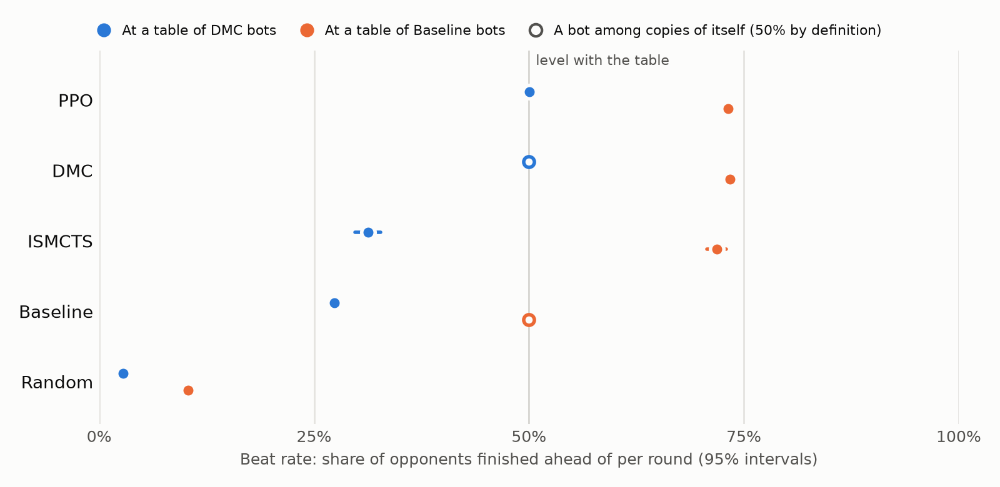
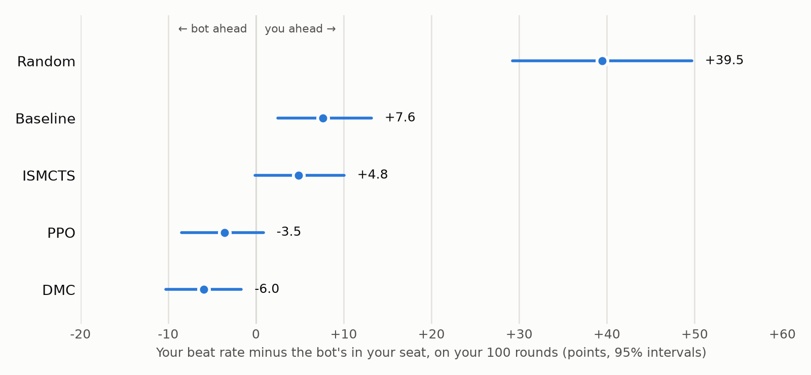

# President RL

President is a card game project with two parts:

- A Python backend for the game engine, bots, CLI tournaments, RL training, and the FastAPI websocket server.
- A Svelte frontend for the browser UI, where you play against 3 to 6 bots.


## Architecture

</img>

I kept the game engine synchronous to allow multiprocessing across CPU cores for ISMCTS parallelism and RL training without event-loop bottlenecks. The server runs bot decisions in a thread (`asyncio.to_thread`) so the websocket stays responsive.

## Bots

- **Random**: Picks a random legal move. Available in the CLI only.
- **Baseline**: Hardcoded rule-based bot modeled after human playstyles.
- **ISMCTS**: (Information Set Monte Carlo Tree Search), creates possible game states from the current state, plays them out, results are backpropagated up the tree to determine which move is statistically the most successful. The possible states favour hands that explain the opponents' moves so far this round. Thinks for 1 second per move.
- **DMC**: (Deep Monte Carlo) Q-value network over 125 move actions, trained through self-play with round placement rewards. It also chooses which cards to pass. The web game averages two independently trained models (`bots/DMC.pt` and `bots/DMCW.pt`) into an ensemble.

### Tried

- **Asymmetric PPO Actor-Critic**: (Proximal Policy Optimization) with action masking, Critic sees opponent hands to compute GAE (Generalized Advantage Estimation) advantages. It plays at the DMC ensemble's level but doesn't beat it, see [PPO Training](#ppo-training).

### Dropped

- **Master-Student DMC**: Master is trained with knowing opponent hands, guiding a student model. Dropped after the PPO outcome: its critic already saw every opponent's hand and still couldn't guide the actor past the ensemble.

## How Strong Are the Bots?

To test a player, we seat it at a table where every other seat is the same bot. Then we deal the same cards again with the player in each seat, so everyone gets the good and the bad hands once. Each player was measured at two tables: one of DMC bots, the strongest, and one of Baseline bots, which play like a careful casual player.

**Beat rate** is the share of opponents a player finishes ahead of in a round. 50% means as good as the table. 100% would mean finishing first every round, and 0% last every round.

<picture>
  <source media="(prefers-color-scheme: dark)" srcset="./public/bot_strength_dark.png">
  
</picture>

| Player   | How it decides                                                   | Think time | Beat rate at a DMC table | At a Baseline table | Finishes first | Finishes last |
| -------- | ---------------------------------------------------------------- | ---------- | ------------------------ | ------------------- | -------------- | ------------- |
| Random   | Any legal move                                                   | instant    | 2.8% ± 0.1               | 10.3% ± 0.2         | 0.2%           | 90%           |
| Baseline | Fixed rules: play low cards first, hold back 2s and high triples | instant    | 27.3% ± 0.5              | 50% (itself)        | 7.1%           | 47%           |
| ISMCTS   | Guesses the hidden hands, plays each option out many times       | 1 s / move | 31.3% ± 1.5              | 71.8% ± 1.1         | 8.7%           | 41%           |
| PPO      | Neural network that started as a copy of DMC, trained further    | instant    | 50.1% ± 0.5              | 73.1% ± 0.4         | 18.4%          | 18%           |
| DMC      | Neural network that learned by playing millions of rounds        | instant    | 50% (itself)             | 73.4% ± 0.4         | 18.2%          | 18%           |

± is a 95% confidence interval. Beat rates count tables of 4 to 7 players equally. Finishing first and last are at a DMC table, where luck alone would put a player first, or last, about 18% of the time.

### Why This Order

- **The card exchange snowballs.** Whoever finishes last becomes Scum and has to give their best cards to the President. A strong player climbs out of that hole; a weak one stays in it.
  - At a DMC table, Random finishes last 90% of the time. After finishing last it avoids last place again only 8% of the time.
  - At a Baseline table, DMC keeps the President role 64% of the time (Baseline among its own copies: 45%). After finishing last, it avoids last place again 92% of the time (Baseline: 77%).
- **ISMCTS assumes everyone plays like Baseline.** When it imagines how a round plays out, every player in its imagination, itself included, plays like Baseline. Against real Baseline bots that guess is right, and it comes close to DMC (71.8% against 73.4%). Against DMC bots the guess is wrong, and it is only a little better than Baseline (31.3% against 27.3%).
- **PPO ties DMC.** It started as a copy of DMC and still picks the same move 88% of the time. Further training didn't find anything better (see [PPO Training](#ppo-training)).
- **Skill matters most at small tables.** At a DMC table, Baseline beats 21% of its opponents with 4 players and 32% with 7. With more players, a player's own choices decide less of where they finish.

### Where Does a Human Fit?

About 100 rounds of play are too few for a fair comparison on their own: with that many rounds, luck of the deal alone moves a beat rate by ±10 percentage points or more. So the web game has a benchmark mode that records the deal of every round. Afterwards, each round is played again from the same start, with the same cards, roles and opponents, but with a bot in the human's seat. Comparing the human with each bot on the very same rounds takes most of the luck out: the uncertainty drops to about ±5 points, as much as several hundred ordinary rounds would give. See [Bot Strength](#bot-strength) to measure yourself.

I played 100 rounds at tables of DMC bots, one game of 25 rounds at each of 4, 5, 6 and 7 players. My plain beat rate was 48.1%, but without the replays the 95% range runs from 35% to 61%.

<picture>
  <source media="(prefers-color-scheme: dark)" srcset="./public/human_vs_bots_dark.png">
  
</picture>

| Bot in my seat | Its beat rate | Me minus the bot | 95% range        | Chance I'm better |
| -------------- | ------------- | ---------------- | ---------------- | ----------------- |
| Random         | 8.6%          | +39.5            | +29.2 to +49.7   | 100%              |
| Baseline       | 40.4%         | +7.6             | +2.5 to +13.2    | 99.8%             |
| ISMCTS         | 43.2%         | +4.8             | −0.1 to +10.0    | 97%               |
| PPO            | 51.6%         | −3.5             | −8.5 to +0.9     | 6%                |
| DMC            | 54.0%         | −6.0             | −10.3 to −1.7    | 0.3%              |

On the same cards I finished ahead of Random, Baseline and ISMCTS, and behind PPO and DMC. Against Baseline and DMC the result is clear. Against ISMCTS and PPO it is likely, but a few dozen more rounds would settle it.

**Where that puts me on the ranking.** Each replay starts from the role I had in that round, so it compares play round by round and leaves out the snowball of the card exchange. Over a 10-round game the gaps grow: on my rounds Baseline trails DMC by 13.6 points, on the ladder by 22.7, about 1.7 times as much. Scaling my 6-point gap to DMC the same way puts me at roughly **40% at a DMC table**, between ISMCTS (31%) and DMC (50%).

My gap to DMC shrank from 7.7 points in my first 50 rounds to 4.3 in my last 50. That could mean I got used to the bots, but it is well within the noise. It also isn't a clean test of learning: I played the table sizes in order, so my first 50 rounds were the 4- and 5-player games. I didn't study how DMC plays, and I can't see its cards or keep track of everything it played. I think my style suits bigger tables better: I'm used to playing this game with a lot of friends at once, and at the bigger tables I noticed myself playing more aggressively.

| Players      | 4     | 5    | 6    | 7    |
| ------------ | ----- | ---- | ---- | ---- |
| Me minus DMC | −13.3 | −2.0 | −7.2 | −1.3 |

The 4-player gap stands out, but with 25 rounds per size each of these numbers is uncertain by about ±10 points. Gaps shrink at bigger tables for the bots too: on the ladder, Baseline trails DMC by 29 points at 4 players and by 18 at 7.

<details>
<summary>Method details</summary>

- **Bots:** 800 deal sequences per bot and table (120 for ISMCTS, which thinks for about 6.5 s per round), 200 (30) each at 4, 5, 6 and 7 players. Each sequence is 10 rounds, so roles carry over, and is played once with the bot in every seat. Every bot at the same table plays the same deals.
- **Score:** a round's finish maps to −1 (last) to +1 (first), and beat rate is (score + 1) / 2. Intervals come from the spread of the per-sequence scores.
- **Human:** Random and ISMCTS make random choices, so their replays are averaged over 8 runs. The other bots always make the same move, so one replay each is enough. The intervals come from a bootstrap that resamples runs of 5 consecutive rounds, since one round's finish sets the next round's roles.
- **Check:** with the Baseline bot standing in for the human, 20 simulated sessions of 100 rounds each gave an interval of ±4.7 points against DMC, and all 20 covered the true value. A DMC bot replaying its own rounds reproduced every round exactly.

</details>

## Custom Rules

- 4 to 7 players. The holder of the 3 of Clubs starts the first round by playing 3s, the Scum starts every round after that.
- Must play card value higher and card count equal or higher than currently on the pile, up to 4 cards.
- 2s act as wildcards when played with other cards, or as the highest card value.
- The pile clears as soon as nobody left to answer could beat it, such as after a 2, or an Ace once every 2 is played. This is judged only from what everyone can see (the cards played, hand sizes and passes), so it gives nothing away. A jump-in chance still comes first.
- A player can jump in out of turn if they can make a quad out of the last played move, even after passing. Jumping in clears the pile and the jumper leads the next one.
- Finishing your hand with a 2 ranks you last for that round.
- After a round ends, 'winning' players ((Vice-)President, Secretary) can choose which cards to pass. 'Losing' players ((High-)Scum, Clerk) must pass their highest cards. Citizens are exempt from card passing.

| Players | Roles (best to worst)                                         | Cards exchanged         |
| ------- | ------------------------------------------------------------- | ----------------------- |
| 4       | President, Vice-President, High-Scum, Scum                    | 2 / 1                   |
| 5       | President, Vice-President, Citizen, High-Scum, Scum           | 2 / 1                   |
| 6       | President, Vice-President, Secretary, Clerk, High-Scum, Scum  | 3 / 2 / 1               |
| 7       | Same as 6, with a Citizen in the middle                       | 3 / 2 / 1               |

Cards exchanged are President ↔ Scum / Vice-President ↔ High-Scum / Secretary ↔ Clerk.

## Repo Layout

```text
Presidenten/
├── backend/                    # Python codebase (run commands from here)
│   ├── bots/                   # Trained DMC checkpoints used by the server
│   ├── dmc_loop/               # DMC training loop (train, evaluate, orchestrate)
│   ├── game/                   # Synchronous game engine, CLI prompts & tournaments
│   ├── playerTypes/            # Human player & bots (Random, Baseline, ISMCTS, DMC, PPO)
│   ├── ppo_loop/               # PPO training loop (distill, train, evaluate, orchestrate, gates)
│   ├── results/                # Bot ladder & human placement results
│   ├── tests/                  # Pytest suite (engine, jump-ins, server, full games, ladder)
│   ├── utils/                  # Self-play, training, Elo league & head-to-head helpers
│   ├── benchmark.py            # Pit two DMC checkpoints head-to-head
│   ├── bot_ladder.py           # Rank the bots at DMC and Baseline tables
│   ├── human_placement.py      # Place a human among the bots from logged rounds
│   ├── main.py                 # FastAPI WebSocket server
│   ├── plot_bot_strength.py    # Draw the bot strength chart
│   └── run_cli.py              # Terminal tournaments between any player types
│
├── frontend/                   # Svelte/TypeScript codebase
│   ├── public/                 # Static assets, card SVGs
│   └── src/
│       ├── assets/             # Card & rules components
│       ├── lib/
│       │   ├── components/     # Lobby, opponent seats & round summary
│       │   ├── themes.ts       # Table color themes
│       │   ├── transitions.ts  # Svelte card & game transitions
│       │   └── types.ts        # Shared types
│       ├── stores/             # Svelte state management
│       └── App.svelte          # Main game table
│
├── public/                     # README images
├── requirements.txt            # Backend dependencies
└── requirements-dev.txt        # Backend dependencies + pytest
```

## Quick Start

Requires Python 3.13 and Node.js 20.19+ (or 22.12+).

### Launch Backend

```Bash
python -m venv .venv
# Linux/macOS
source .venv/bin/activate
# Windows
.\.venv\Scripts\Activate.ps1

pip install -r requirements.txt
cd backend
uvicorn main:app --reload
```

The server listens on `ws://localhost:8000/ws/game`. It uses the GPU when one is available and falls back to the CPU otherwise.

On Windows, `pip` installs the CPU build of PyTorch. For CUDA, install PyTorch from the [PyTorch index](https://pytorch.org/get-started/locally/) first, e.g. `pip install torch==2.12.1 --index-url https://download.pytorch.org/whl/cu132`. On Linux, the default build already includes CUDA.

### Launch Frontend

```Bash
cd frontend
npm i
npm run dev
```

To point the frontend at a different server, set `VITE_WS_URL` (e.g. in `frontend/.env.local`).

## Backend Tools

All commands are run from `backend/` with the virtual environment active.

### CLI Tournaments

```Bash
python run_cli.py
```

Prompts for the number of players, rounds, and a player type per seat (Human, Random, Baseline, ISMCTS, DMC), then plays 1000 games and prints the scores. Without a human you can pick game parallelism (whole games across processes) or search parallelism (ISMCTS searches across processes).

### DMC Training

```Bash
python -m dmc_loop.orchestrate_dmc
```

Runs league cycles until training plateaus, resuming from `snapshots/latest_model.pt` if it exists:

1. **Train** (`dmc_loop.train_dmc`): 2000 batches of self-play against the live model, elite snapshots and the Baseline bot.
2. **Evaluate** (`dmc_loop.evaluate_dmc`): Elo tournament of the new snapshots, elites, milestones and the Baseline bot. The top 8 become the new elites.
3. **Stop check** (every 3 cycles): Head-to-head of the best elite against an anchor. If it stops improving, the learning rate is cut, and training stops once it reaches its floor.

Snapshots, elites and evaluation results are written to `backend/snapshots/`.

### PPO Training

PPO trains a policy that plays from its own information, with a critic that also sees every opponent's hand during training, for lower-variance advantages than DMC's Monte Carlo targets. It starts from the DMC ensemble and passes cards with the DMC passer.

1. **Distill** (`python -m ppo_loop.distill_ppo`): clones the DMC ensemble's policy into the actor and pretrains the critics on its games. `--dagger` continues with the student playing, `--critics` trains only the critics, and `--arch flat|seat|pairwise` picks the critic architecture.
2. **Gate 1** (`python -m ppo_loop.gates_ppo gate1`): the distilled actor has to play at parity with the ensemble over 2400 head-to-head games.
3. **Train** (`python -m ppo_loop.orchestrate_ppo`): league cycles as for DMC. Every 3 cycles, gate 2 plays the best elite against the ensemble and the distilled start, and gives up if training stops improving.

Snapshots, the frozen DMC elites and gate results are written to `backend/snapshots_ppo/`.

**Outcome.** The distilled actor passed gate 1 (−0.005, 95% CI [−0.011, +0.001] against the ensemble). Fifteen training cycles (about 1.8M games) then gained about +0.005 over the distilled start, which brought PPO level with the ensemble (final model +0.002, [−0.004, +0.009]) but not past it, so gate 2 gave up.

The premise didn't hold: seeing every hand barely helps to predict a round's outcome. The critic with every opponent's hand explains 0.77 of the outcome's variance, against 0.74 for one with only the actor's information. That makes the advantages only about 1.2× less noisy than without the hidden hands. Flat, per-seat and pairwise critics all stall there. Replaying rounds from the true state shows that about 0.88 is predictable, so the gap lies in judging how the rest of a round plays out, not in hidden information. Giving the critic each opponent's played cards made no difference either.

### Benchmark

```Bash
python benchmark.py
```

Plays two checkpoints (`MASTER_PATH` vs `OLD_PATH`) against each other in paired, seeded games and reports the score difference with a 95% confidence interval, stopping early once the result is clear. A tuple of checkpoints, such as `("bots/DMC.pt", "bots/DMCW.pt")`, plays as their averaged ensemble.

### Bot Strength

```Bash
python bot_ladder.py               # every bot at a DMC table and at a Baseline table
python bot_ladder.py --only ISMCTS # some bots; --field DMC for one table, --force to rerun
python plot_bot_strength.py        # redraws the charts in public/
```

Runs the [bot ladder](#how-strong-are-the-bots) and saves it to `results/bot_ladder.json`, skipping finished runs. The fast bots take under a minute each. ISMCTS takes about 1.5 h per table on 8 cores and should have the machine to itself, as it thinks for a fixed time. PPO needs a model under `snapshots_ppo/`, which isn't in the repo.

To place yourself, start the server in benchmark mode and play at tables of DMC bots only, ideally about 25 rounds each at 4, 5, 6 and 7 players:

```PowerShell
$env:PRESIDENT_BENCHMARK_LOG = "results/human_rounds.jsonl"; uvicorn main:app
```

```Bash
PRESIDENT_BENCHMARK_LOG=results/human_rounds.jsonl uvicorn main:app  # Linux/macOS
python human_placement.py results/human_rounds.jsonl
```

`human_placement.py` replays every logged round with each bot in your seat. It prints your result against each bot with a 95% interval and the chance that you are ahead, and saves it to `results/human_placement.json`. The chart script then also draws `public/human_vs_bots_{light,dark}.png`. The replays take about 15 minutes, most of it ISMCTS. `--dry-run Baseline` checks the intervals by letting a bot play the human's seat.

### Tests

```Bash
pip install -r requirements-dev.txt
pytest
```
