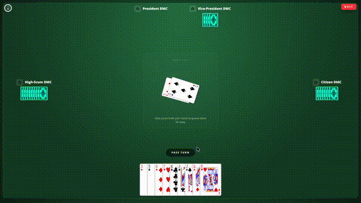

# President RL

President is a card game project with two parts:

- A Python backend for the game engine, bots, CLI tournaments, RL training, and the FastAPI websocket server.
- A Svelte frontend for the browser UI, where you play against 3 to 6 bots.



## Architecture

</img>

I kept the game engine synchronous to allow multiprocessing across CPU cores for ISMCTS parallelism and RL training without event-loop bottlenecks. The server runs bot decisions in a thread (`asyncio.to_thread`) so the websocket stays responsive.

## Bots

- **Random**: Picks a random legal move.
- **Baseline**: Hardcoded rule-based bot modeled after human playstyles.
- **ISMCTS**: (Information Set Monte Carlo Tree Search), creates possible game states from the current state, plays them out, results are backpropagated up the tree to determine which move is statistically the most successful. Available in the CLI only.
- **DMC**: (Deep Monte Carlo) Q-value network over 125 move actions, trained through self-play with round placement rewards. It also chooses which cards to pass. The web game averages two independently trained models (`bots/DMC.pt` and `bots/DMCW.pt`) into an ensemble.

### Planned

- **Master-Student DMC**: Master is trained with knowing opponent hands, guiding a student model.
- **Asymmetric PPO Actor-Critic**: (Proximal Policy Optimization) with action masking, Critic sees opponent hands to compute GAE (Generalized Advantage Estimation) advantages.

## Custom Rules

- 4 to 7 players. The holder of the 3 of Clubs starts the first round by playing 3s, the Scum starts every round after that.
- Must play card value higher and card count equal or higher than currently on the pile, up to 4 cards.
- 2s act as wildcards when played with other cards, or as the highest card value. Playing 2s on their own clears the pile.
- A player can jump in out of turn if they can make a quad out of the last played move, even after passing. Jumping in clears the pile and the jumper leads the next one.
- Finishing your hand with a 2 ranks you last for that round.
- After a round ends, 'winning' players ((Vice-)President, Secretary) can choose which cards to pass. 'Losing' players ((High-)Scum, Clerk) must pass their highest cards. Citizens are exempt from card passing.

| Players | Roles (best to worst)                                         | Cards exchanged         |
| ------- | ------------------------------------------------------------- | ----------------------- |
| 4       | President, Vice-President, High-Scum, Scum                    | 2 / 1                   |
| 5       | President, Vice-President, Citizen, High-Scum, Scum           | 2 / 1                   |
| 6       | President, Vice-President, Secretary, Clerk, High-Scum, Scum  | 3 / 2 / 1               |
| 7       | Same as 6, with a Citizen in the middle                       | 3 / 2 / 1               |

Cards exchanged are President ↔ Scum / Vice-President ↔ High-Scum / Secretary ↔ Clerk.

## Repo Layout

```text
Presidenten/
├── backend/                    # Python codebase (run commands from here)
│   ├── bots/                   # Trained DMC checkpoints used by the server
│   ├── dmc_loop/               # DMC training loop (train, evaluate, orchestrate)
│   ├── game/                   # Synchronous game engine, CLI prompts & tournaments
│   ├── playerTypes/            # Human player & bots (Random, Baseline, ISMCTS, DMC)
│   ├── tests/                  # Pytest suite (engine, jump-ins, server, full games)
│   ├── utils/                  # Self-play, training, Elo league & head-to-head helpers
│   ├── benchmark.py            # Pit two DMC checkpoints head-to-head
│   ├── main.py                 # FastAPI WebSocket server
│   └── run_cli.py              # Terminal tournaments between any player types
│
├── frontend/                   # Svelte/TypeScript codebase
│   ├── public/                 # Static assets, card SVGs
│   └── src/
│       ├── assets/             # Card & rules components
│       ├── lib/
│       │   ├── components/     # Lobby, opponent seats & round summary
│       │   ├── themes.ts       # Table color themes
│       │   ├── transitions.ts  # Svelte card & game transitions
│       │   └── types.ts        # Shared types
│       ├── stores/             # Svelte state management
│       └── App.svelte          # Main game table
│
├── public/                     # README images
├── requirements.txt            # Backend dependencies
└── requirements-dev.txt        # Backend dependencies + pytest
```

## Quick Start

Requires Python 3.13 and Node.js 20.19+ (or 22.12+).

### Launch Backend

```Bash
python -m venv .venv
# Linux/macOS
source .venv/bin/activate
# Windows
.\.venv\Scripts\Activate.ps1

pip install -r requirements.txt
cd backend
uvicorn main:app --reload
```

The server listens on `ws://localhost:8000/ws/game`. It uses the GPU when one is available and falls back to the CPU otherwise.

On Windows, `pip` installs the CPU build of PyTorch. For CUDA, install PyTorch from the [PyTorch index](https://pytorch.org/get-started/locally/) first, e.g. `pip install torch==2.12.1 --index-url https://download.pytorch.org/whl/cu132`. On Linux, the default build already includes CUDA.

### Launch Frontend

```Bash
cd frontend
npm i
npm run dev
```

To point the frontend at a different server, set `VITE_WS_URL` (e.g. in `frontend/.env.local`).

## Backend Tools

All commands are run from `backend/` with the virtual environment active.

### CLI Tournaments

```Bash
python run_cli.py
```

Prompts for the number of players, rounds, and a player type per seat (Human, Random, Baseline, ISMCTS, DMC), then plays 1000 games and prints the scores. Without a human you can pick game parallelism (whole games across processes) or search parallelism (ISMCTS searches across processes).

### DMC Training

```Bash
python -m dmc_loop.orchestrate_dmc
```

Runs league cycles until training plateaus, resuming from `snapshots/latest_model.pt` if it exists:

1. **Train** (`dmc_loop.train_dmc`): 2000 batches of self-play against the live model, elite snapshots and the Baseline bot.
2. **Evaluate** (`dmc_loop.evaluate_dmc`): Elo tournament of the new snapshots, elites, milestones and the Baseline bot. The top 8 become the new elites.
3. **Stop check** (every 3 cycles): Head-to-head of the best elite against an anchor. If it stops improving, the learning rate is cut, and training stops once it reaches its floor.

Snapshots, elites and evaluation results are written to `backend/snapshots/`.

### Benchmark

```Bash
python benchmark.py
```

Plays two checkpoints (`MASTER_PATH` vs `OLD_PATH`) against each other in paired, seeded games and reports the score difference with a 95% confidence interval, stopping early once the result is clear.

### Tests

```Bash
pip install -r requirements-dev.txt
pytest
```
